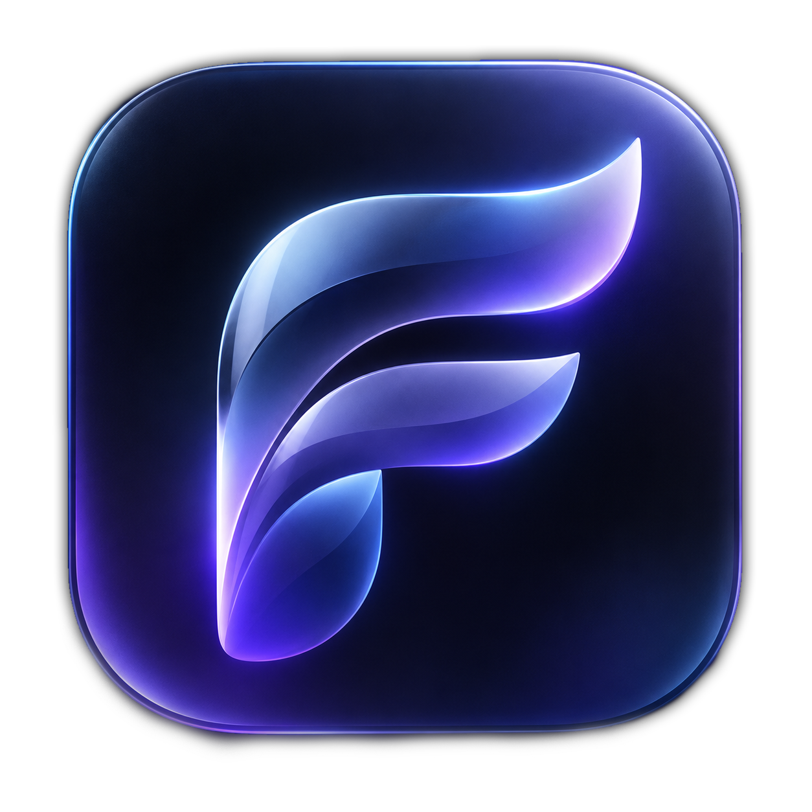
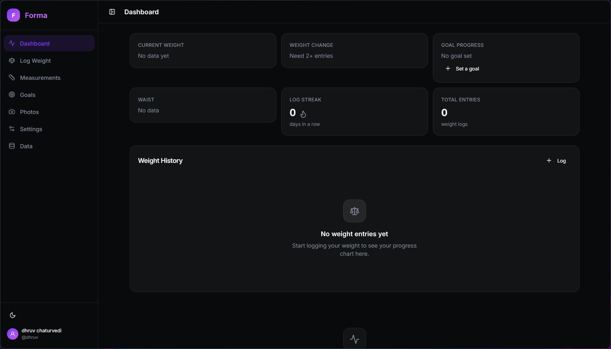
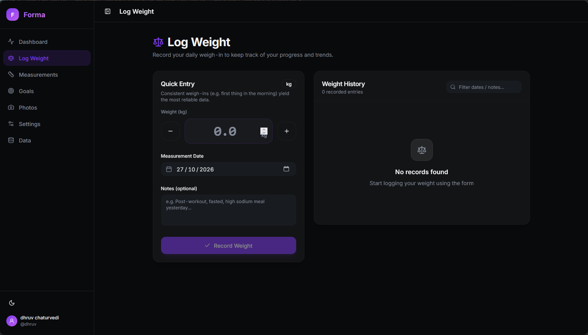
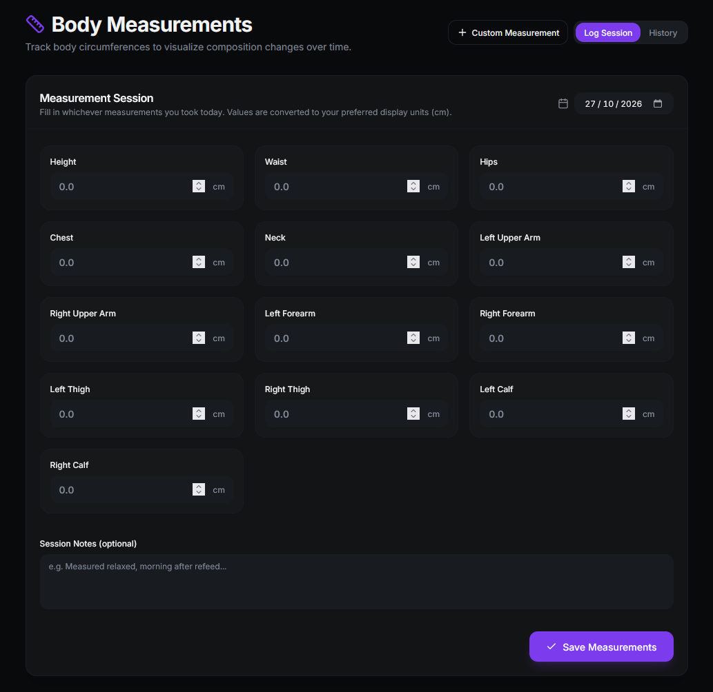
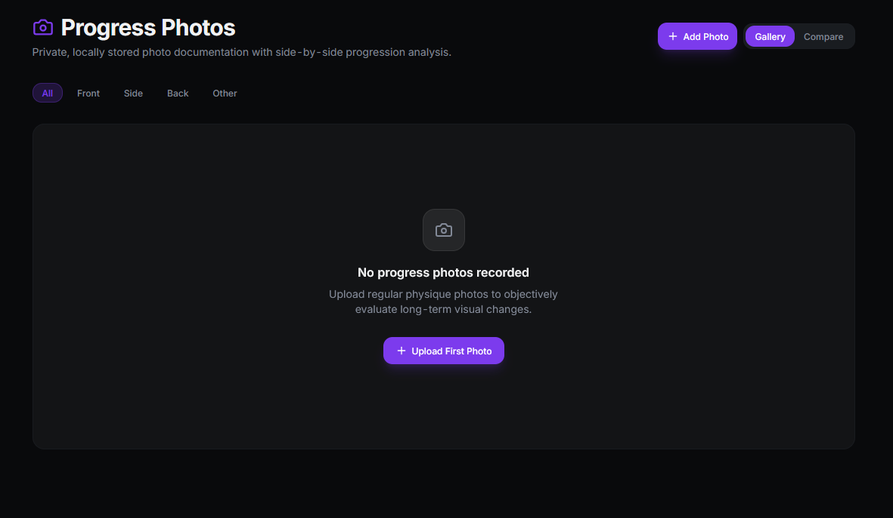

<div align="center">



# Forma — Premium Body Progress Tracker

<p align="center">
  <strong>A premium, self-hosted body measurement and weight tracking web application.</strong><br>
  Privacy-first, zero telemetry, no external accounts, refined glassmorphism design.
</p>

[](https://github.com/dhruvcx-1/Forma/actions/workflows/publish.yml)


</div>

---

## ✨ Features

- ⚖️ **Weight Tracking & Trends** — Rapid daily weigh-in with ±0.1 step controls, 7-day moving averages, and duplicate entry safeguards.
- 📏 **Body Circumferences** — Track 13 anatomical sites (waist, hips, chest, arms, thighs, calves) with custom site definitions and per-measurement progression charts.
- 🧬 **Body Composition** — Deterministic US Navy Hodgdon-Beckett circumference formula & WHO BMI classification with visible formula transparent assumptions.
- 🎯 **Target Goals & Pacing** — SVG circular milestone visualizer, required weekly pace calculations, and estimated completion trajectories.
- 📸 **Private Progress Photos** — Local filesystem storage (JPEG/PNG/WebP), timeline gallery by perspective (front/side/back), and side-by-side before/after comparison.
- 👤 **Custom Profiles & Avatars** — Upload and manage personal avatar pictures with automatic cleanup, custom display names, and bio snippets.
- 🌐 **Public Progress Showcase** — Opt-in public profile page (`/@username` or `/u/username`) to proudly share weight milestones, target goals, and trend charts without requiring visitors to log in. Circumferences, private notes, and photos remain strictly private.
- 📱 **Adaptive Mobile UI & PWA** — Responsive bottom bar, quick top actions, and an expandable slide-over drawer for easy access on mobile devices, plus PWA installation on iOS/Android/Desktop.
- 💎 **Refined Glassmorphism** — Translucent blurred surfaces, high-contrast dark and light modes, smooth transitions, and tabular numeral typography.
- 🔒 **Privacy-First & Self-Hosted** — 100% self-contained SQLite WAL database, Argon2id encryption, secure session cookies, zero external telemetry, zero third-party cloud calls.
- 💾 **Data Portability** — Complete JSON database backups and CSV spreadsheets for weight and measurement records.

---

## 📸 Visual Showcase

### 📊 Comprehensive Dashboard
> Interactive time-series weight trends with gradient fills, sparklines, 7-day moving averages, and goal tracking.

<div align="center">
  
</div>

---

### ⚖️ Streamlined Weigh-in Logger
> Rapid single-tap weight recording, ±0.1 steppers, previous entry comparison delta, and chronological history with notes.

<div align="center">
  
</div>

---

### 📏 Circumference Measurements
> Multi-site batch recording sessions, automatic unit conversion (metric cm / imperial in), and detailed individual trend histories.

<div align="center">
  
</div>

---

### 📷 Private Progress Photos & Comparison
> Auth-gated photo uploads, multi-angle views (front, side, back), and side-by-side progression comparison.

<div align="center">
  
</div>

---

## 🚀 Quick Start with Docker

Forma is packaged as a lightweight, production-ready container image published to GitHub Container Registry (**GHCR**).

### Prerequisites
- Docker and Docker Compose
- Minimum 512 MB RAM

### Deploy in 2 Steps

```bash
# 1. Download environment template
curl -sO https://raw.githubusercontent.com/dhruvcx-1/Forma/master/.env.example
cp .env.example .env

# Edit .env and set COOKIE_SECRET to a random 32+ character string:
# Linux/macOS:  openssl rand -hex 32
# PowerShell:   [System.Convert]::ToBase64String([System.Security.Cryptography.RandomNumberGenerator]::GetBytes(32))

# 2. Start the container
docker compose up -d
```

Open your browser at **`http://localhost:8080`**. On first launch, you will be guided through setting up your private master profile.

---

## ⚙️ Configuration

All runtime options are managed via environment variables in `.env`:

| Variable | Default | Purpose |
|---|---|---|
| `COOKIE_SECRET` | *(required)* | 32+ character random string for signing secure session cookies |
| `EXTERNAL_PORT` | `8080` | Host port exposed to your local network |
| `PORT` | `3001` | Internal Node.js Fastify listener port |
| `DATABASE_PATH` | `/app/data/body-tracker.db` | SQLite database file location inside container |
| `PHOTOS_PATH` | `/app/data/photos` | Storage directory for progress photos |
| `NODE_ENV` | `production` | Set to `production` or `development` |
| `CORS_ORIGIN` | `http://localhost:8080` | Allowed origin for CSRF and API requests |
| `GHCR_IMAGE` | `ghcr.io/dhruvcx-1/forma:latest` | Container image reference |

---

## 📦 Container Registry (GHCR)

The production multi-arch image (`linux/amd64` and `linux/arm64`) is automatically built on every commit and hosted at:

```bash
ghcr.io/dhruvcx-1/forma:latest
```

### Pulling manually:
```bash
docker pull ghcr.io/dhruvcx-1/forma:latest
```

### Upgrading your container:
```bash
docker compose pull
docker compose up -d --force-recreate
```

---

## 🔒 Security & Privacy Architecture

- **No Remote Telemetry**: No Google Analytics, Segment, Sentry, or third-party trackers.
- **Argon2id Hashing**: Password hashing uses the industry gold-standard memory-hard Argon2id algorithm.
- **Session Tokens**: 30-day cryptographically random session tokens stored in SQLite and transmitted over `HttpOnly`, `SameSite=Strict` cookies.
- **Auth-Gated Assets**: Uploaded progress photos are not exposed through public static directories; each request is authenticated before binary image streaming.
- **Strict File Upload Constraints**: Uploads are restricted to JPEG, PNG, and WebP formats up to 10MB. Filenames are assigned randomized `nanoid` identifiers to prevent path traversal attacks.

---

## 💾 Backup and Restoration

### 1. Web UI Backup
Visit the **Data** page in the application to download:
- Full JSON backup archive
- Weight History CSV
- Circumference Measurements CSV

### 2. Low-Level Docker Volume Backup
To snapshot your database and progress photos simultaneously:

```bash
# Stop container for consistency
docker compose stop

# Archive volume to a tarball
docker run --rm \
  -v forma_data:/source \
  -v $(pwd)/backups:/backup \
  alpine tar czf /backup/forma-backup-$(date +%Y%m%d).tar.gz -C /source .

# Restart container
docker compose start
```

### Restoration:
```bash
docker compose stop

docker run --rm \
  -v forma_data:/target \
  -v $(pwd)/backups:/backup \
  alpine sh -c "cd /target && tar xzf /backup/forma-backup-YYYYMMDD.tar.gz"

docker compose start
```

---

## 🌐 Reverse Proxy Configuration

When exposing Forma to the public internet, place it behind a reverse proxy that terminates TLS (HTTPS).

### Nginx Example:
```nginx
server {
    listen 443 ssl http2;
    server_name forma.yourdomain.com;

    ssl_certificate /etc/letsencrypt/live/forma.yourdomain.com/fullchain.pem;
    ssl_certificate_key /etc/letsencrypt/live/forma.yourdomain.com/privkey.pem;

    client_max_body_size 15M; # Support photo uploads

    location / {
        proxy_pass http://localhost:8080;
        proxy_set_header Host $host;
        proxy_set_header X-Real-IP $remote_addr;
        proxy_set_header X-Forwarded-For $proxy_add_x_forwarded_for;
        proxy_set_header X-Forwarded-Proto $scheme;
    }
}
```

### Caddy Example:
```caddy
forma.yourdomain.com {
    reverse_proxy localhost:8080
}
```

> **Note**: Update `CORS_ORIGIN=https://forma.yourdomain.com` in your `.env` when deploying behind a domain.

---

## 🛠️ Local Development

### Prerequisites
- Node.js 22+
- npm 10+

```bash
# 1. Clone the repository
git clone https://github.com/dhruvcx-1/Forma.git
cd Forma

# 2. Install dependencies
npm install

# 3. Start development servers concurrently (Fastify on 3001, Vite on 5173)
npm run dev

# 4. Run automated test suite
npm test

# 5. Build production bundle
npm run build
```

---

## 🧰 Technology Stack

| Layer | Technologies |
|---|---|
| **Frontend** | React 18, TypeScript, Vite, Tailwind CSS, shadcn/ui primitives |
| **Data Viz** | Recharts, Custom SVG circular progress meters, Lucide Icons |
| **Animation** | Framer Motion (Motion for React) |
| **Backend** | Node.js 22, Fastify, TypeScript, Zod |
| **Database** | SQLite via `better-sqlite3` with Write-Ahead Logging (WAL) |
| **Testing** | Vitest |
| **Deployment** | Multi-stage Docker, Docker Compose, GitHub Actions (GHCR) |

---

## 📄 License

Licensed under the [MIT License](LICENSE). Built for self-hosters and privacy advocates.

---

<div align="center">
  <sub>Made with ❤️ by <strong>Dhruv Chaturvedi</strong>.</sub>
</div>
