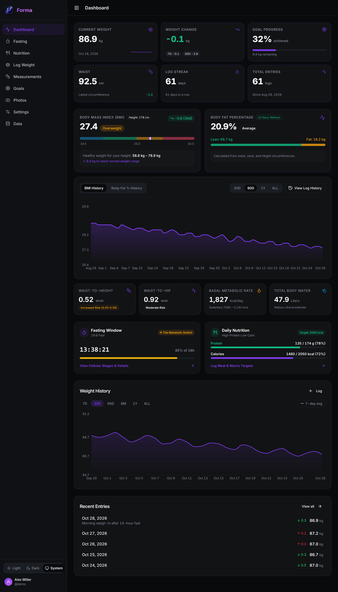
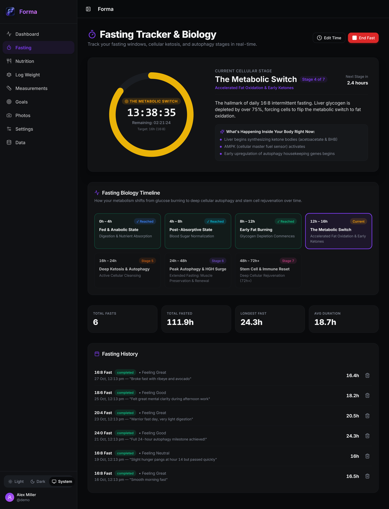
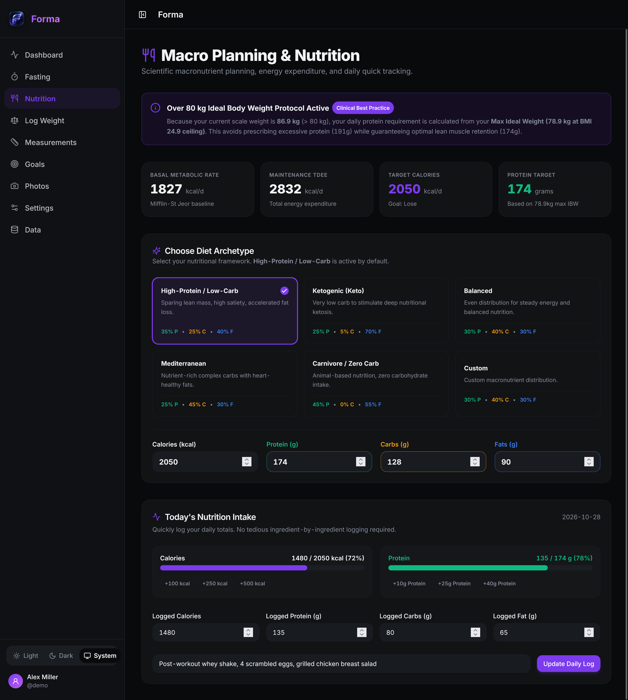
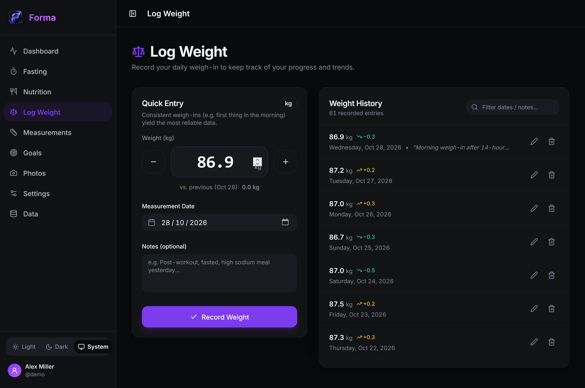
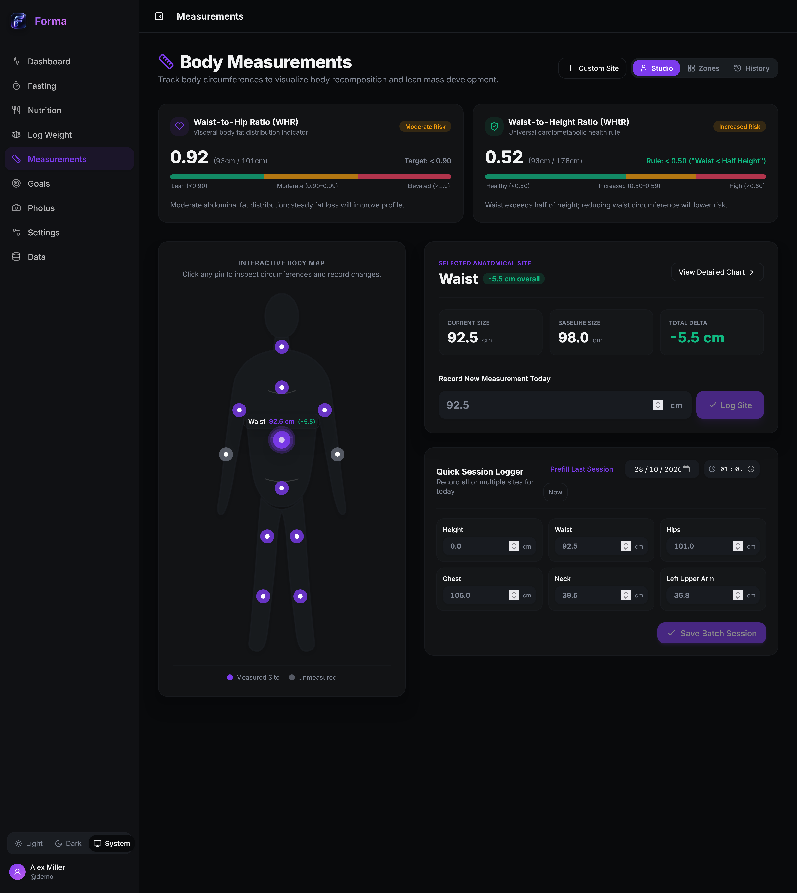
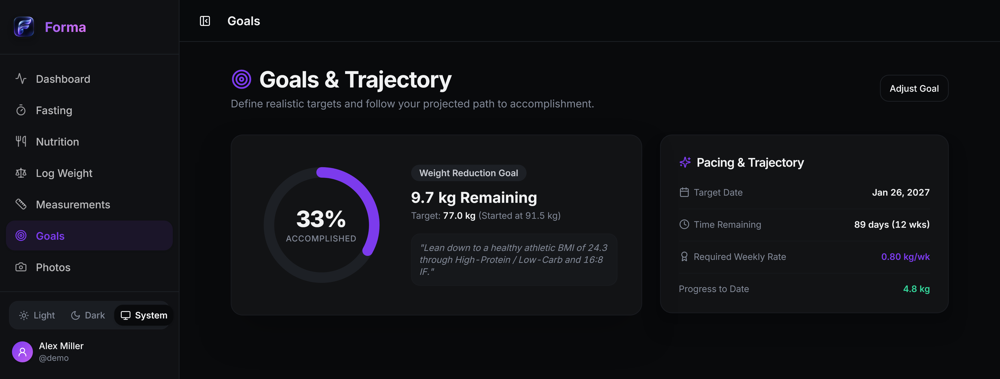
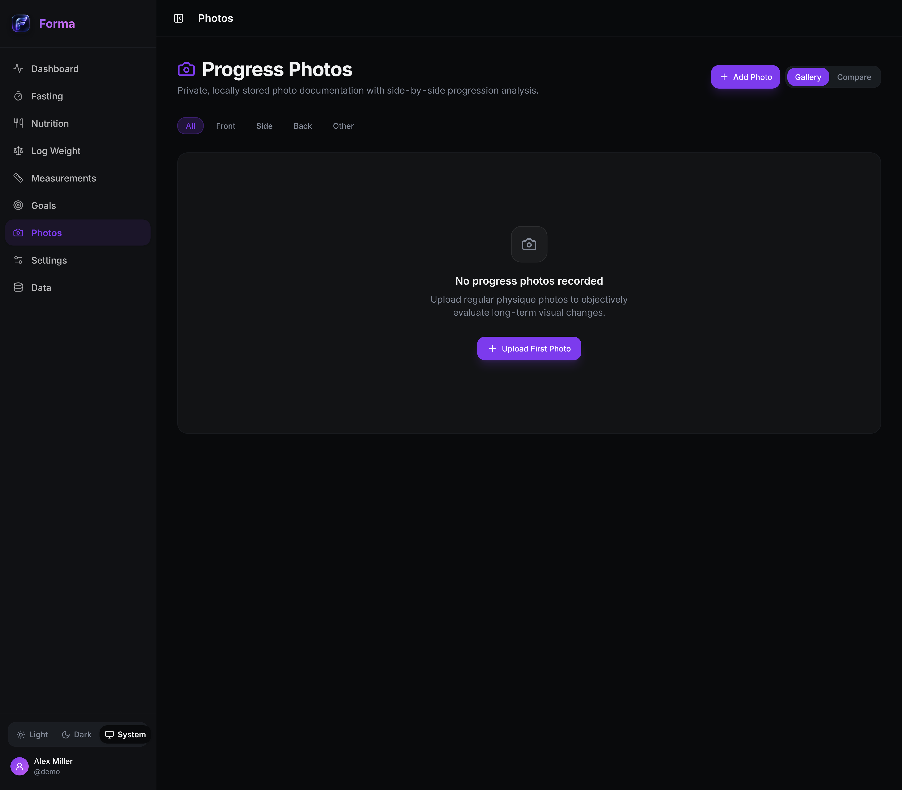
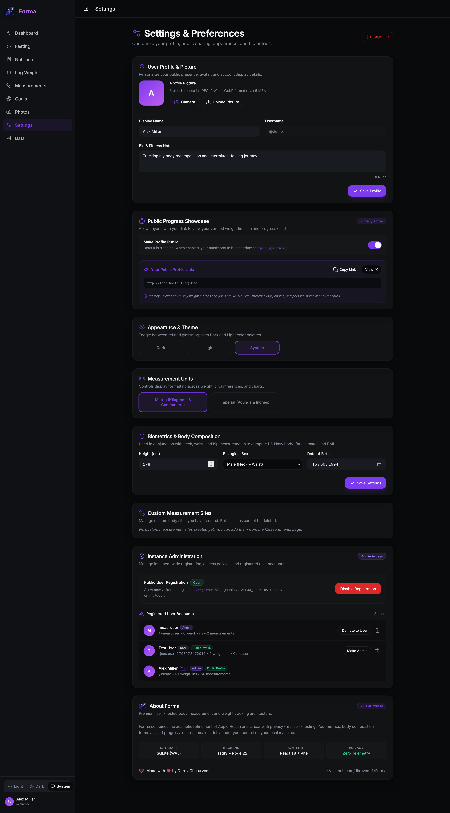
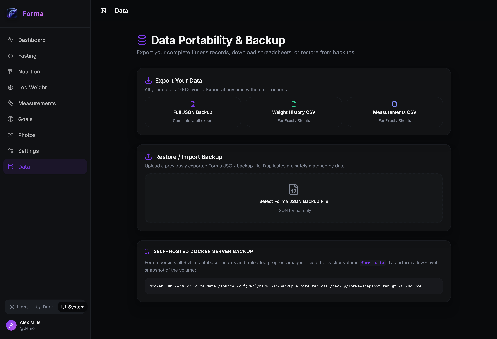

# 📸 Forma Interface & Feature Gallery

Explore the complete visual tour of **Forma**, showcasing its refined glassmorphism design, clinical health metrics, fasting stage engine, and privacy-first tracking architecture.

---

## 📑 Visual Index

1. [📊 Dashboard & Clinical Overview](#1--dashboard--clinical-overview)
2. [⏱️ Fasting Tracker & Biological Stages](#2-️-fasting-tracker--biological-stages)
3. [🥗 Macro Planning & Nutrition Engine](#3--macro-planning--nutrition-engine)
4. [⚖️ Streamlined Weigh-in Logger](#4-️-streamlined-weigh-in-logger)
5. [📏 Body Measurements Studio & Anatomical Silhouette](#5--body-measurements-studio--anatomical-silhouette)
6. [🎯 Goals & Milestone Trajectory](#6--goals--milestone-trajectory)
7. [📷 Private Progress Photos & Comparison](#7--private-progress-photos--comparison)
8. [⚙️ Settings, Preferences & Instance Administration](#8-️-settings-preferences--instance-administration)
9. [💾 Data Portability, Backups & Export](#9--data-portability-backups--export)

---

## 1. 📊 Dashboard & Clinical Overview

The unified command center displaying real-time vitals, clinical composition ratios, active metabolic states, and trend graphs at a single glance.

  

### Key Capabilities:
- **Primary Metric Cards**: Current scale weight, weekly/monthly weight change deltas, goal progress percentage, waist circumference, continuous log streak, and lifetime check-in count.
- **Body Mass Index (BMI)**: Continuous color-coded spectrum bracketed by WHO thresholds (Underweight, Normal, Overweight, Obese), featuring personal height-adjusted healthy weight target boundaries.
- **US Navy Body Fat Percentage**: Navy Hodgdon-Beckett algorithm estimating lean body mass vs. fat mass with zero caliper or bioimpedance guesswork.
- **Dual Time-Series History**: Interactive toggle between BMI History and Body Fat % History across 30-day, 90-day, 1-year, and all-time zoom windows.
- **Cardiometabolic Risk Gauge Cards**: Quick clinical indicators for **Waist-to-Height Ratio (WHtR)** and **Waist-to-Hip Ratio (WHR)**.
- **Live State Widgets**: Embedded live fasting window countdown with active cellular stage pill and daily macronutrient budget status (protein grams & calories).

---

## 2. ⏱️ Fasting Tracker & Biological Stages

A continuous fasting engine supporting intermittent (16:8, 18:6, 20:4, 24:0 OMAD) and multi-day extended fasting (36h, 48h, 72h+), paired with a biological stage timeline showing real-time metabolic transitions.

  

### Key Capabilities:
- **Radial Fasting Clock**: Live sub-second elapsed time counter, remaining target countdown, and animated circular progression ring.
- **Current Cellular Stage Card**: Highlights exactly which metabolic phase you are currently in with actionable biological details (e.g. AMPK activation, ketone synthesis, autophagy upregulation).
- **Fasting Biology Timeline (7 Cellular Stages)**:
  1. **Fed & Anabolic State (0–4h)**: Digestion, glucose spike, insulin secretion, and nutrient storage.
  2. **Post-Absorptive State (4–8h)**: Blood sugar normalization, insulin decline, and baseline liver glycogen utilization.
  3. **Early Fat Burning (8–12h)**: Glycogen depletion initiates; free fatty acid mobilization begins.
  4. **The Metabolic Switch (12–16h)**: Hallmark of 16:8 IF; liver glycogen is depleted over 75%, shifting fuel consumption to accelerated fat oxidation and early ketones.
  5. **Deep Ketosis & Autophagy (16–24h)**: Autophagy housekeeping genes turn on to clear cellular debris and misfolded proteins; circulating acetoacetate and beta-hydroxybutyrate rise.
  6. **Peak Autophagy & HGH Surge (24–48h)**: Human Growth Hormone surges up to 500% to preserve lean mass; peak cellular recycling.
  7. **Stem Cell & Immune Reset (48–72h+)**: Old white blood cells broken down; hematopoietic stem cell renewal triggered upon refeeding.
- **Lifetime Fasting Stats**: Total completed fasts, cumulative hours fasted, longest completed fast, and average duration.
- **Fasting History Log**: Filterable chronological history with subjective mood pills (`Feeling Great`, `Good`, `Neutral`, `Struggling`), fast type badges, and meal break notes.

---

## 3. 🥗 Macro Planning & Nutrition Engine

Evidence-based nutritional macro engine calculating individualized caloric targets, basal metabolic rates, and macronutrient gram allocations tailored to specific dietary frameworks.

  

### Key Capabilities:
- **Metabolic Baseline Summary**: Real-time Basal Metabolic Rate (BMR via Mifflin-St Jeor), Maintenance Total Daily Energy Expenditure (TDEE), Target Caloric Deficit/Surplus, and Daily Protein Target.
- **Over 80 kg Ideal Body Weight Protocol**: Clinical best practice rule ensuring users weighing over 80 kg compute protein targets from their **Max Ideal Weight** (BMI 24.9 ceiling) to optimize lean mass retention while avoiding excessive protein overfeeding.
- **6 Nutritional Frameworks (Diet Archetypes)**:
  - 🥇 **High-Protein / Low-Carb (Default)**: 35% Protein, 25% Carbs, 40% Fat — optimized for high satiety and accelerated fat loss.
  - 🥑 **Ketogenic (Keto)**: 25% Protein, 5% Carbs, 70% Fat — very low carb to stimulate deep nutritional ketosis.
  - ⚖️ **Balanced**: 30% Protein, 40% Carbs, 30% Fat — even distribution for general performance.
  - 🫒 **Mediterranean**: 25% Protein, 45% Carbs, 30% Fat — nutrient-dense complex carbohydrates with heart-healthy monounsaturated fats.
  - 🥩 **Carnivore / Zero Carb**: 45% Protein, 0% Carbs, 55% Fat — animal-based nutrition.
  - 🛠️ **Custom Macro Split**: Interactive sliders to adjust custom gram and percentage allocations.
- **Today's Nutrition Intake Logger**: Quick logging interface with single-tap incremental additions (+100, +250, +500 kcal; +10g, +25g, +40g protein) and meal notes without tedious barcode or ingredient friction.

---

## 4. ⚖️ Streamlined Weigh-in Logger

Daily scale weight logging with sub-pound/sub-kilogram increments, instant delta comparison against previous weigh-ins, and duplicate prevention.

  

### Key Capabilities:
- **Quick Entry Pad**: Large numeric display with tactile `-` / `+` steppers (0.1 increments), keyboard input, and active unit badge.
- **Instant Delta Comparison**: Real-time comparison versus your previous weigh-in (`vs. previous: -0.2 kg`).
- **Date Selector & Time-of-Day Context**: Calendar picker supporting historical logs and custom context notes (e.g. *"Fasted morning weigh-in after 16h fast"*).
- **Weight History Timeline**: Searchable and filterable list of all recorded weights with inline edit and delete actions.

---

## 5. 📏 Body Measurements Studio & Anatomical Silhouette

An interactive visual studio featuring a full human anatomical silhouette, cardiometabolic health ratio cards, and multiple recording modes.

  

### Key Capabilities:
- **Cardiometabolic Health Cards**:
  - **Waist-to-Hip Ratio (WHR)**: Evaluates visceral adipose tissue distribution with WHO thresholds (Lean `<0.90`, Moderate `0.90–0.99`, Elevated `≥1.00`).
  - **Waist-to-Height Ratio (WHtR)**: Universal clinical standard (*"Keep your waist to less than half your height"*) with healthy (`<0.50`), increased risk (`0.50–0.59`), and high risk (`≥0.60`) benchmarks.
- **Interactive Anatomical Silhouette (`BodyMapSilhouette`)**: Stylized human vector featuring clickable pulse nodes at standard sites:
  - Neck, Chest, Left & Right Upper Arms (Biceps), Forearms, Waist, Hips, Left & Right Thighs, and Calves.
  - Interactive tooltip reveals site circumference and all-time delta on hover/touch.
- **Three Unified View Modes**:
  1. 🎨 **Studio Mode**: Silhouette on the left + selected site inspector, baseline delta, and quick session logger on the right.
  2. 🗂️ **Zones Mode**: Grouped by anatomical compartments (Core & Torso, Upper Body, Lower Body, Custom Sites) with batch inputs.
  3. 📜 **History Mode**: Searchable chronological timeline with second-level timestamps.
- **Second-Level Timestamp Precision**: Session logging captures exact time of day (`YYYY-MM-DDTHH:mm:ss`) with a dedicated time input and "Now" button, supporting multiple check-ins on the same day with chronological sorting.

---

## 6. 🎯 Goals & Milestone Trajectory

Define realistic target weights, establish deadlines, and visualize projected pacing paths.

  

### Key Capabilities:
- **Circular Milestone Ring**: High-contrast visual ring illustrating exact percent completed (e.g. `33% Accomplished`) alongside remaining weight to lose.
- **Pacing & Trajectory Card**: Calculates the exact required weekly rate of change (e.g. `0.80 kg/wk`) needed to reach the target weight by the deadline.
- **Time Remaining Countdown**: Displays remaining days and weeks until goal date.
- **Progress to Date Tracker**: Total cumulative weight lost since the starting milestone.

---

## 7. 📷 Private Progress Photos & Comparison

Private, self-hosted photographic physique logs stored strictly on your local disk with perspective tagging and comparison tools.

  

### Key Capabilities:
- **Zero Third-Party Cloud Leaks**: Images are stored directly on the host volume (`./data/uploads/photos/`) and served only via authenticated session tokens.
- **Perspective Tagging**: Organize images by pose: `Front`, `Side`, `Back`, or `Other`.
- **Side-by-Side Progression Analysis**: Compare historical baseline photos directly against recent checkpoints to objectively evaluate recomposition.

---

## 8. ⚙️ Settings, Preferences & Instance Administration

Personal customization, appearance preferences, biometrics, and multi-user instance management in one central settings suite.

  

### Key Capabilities:
- **User Profile & Avatar**: Upload custom avatars (JPEG/PNG/WebP), configure display names, and write personal bio snippets.
- **Public Progress Showcase**: Opt-in public profile (`/@username` or `/u/username`) allowing you to share weight loss progress charts and goal milestones with friends or coaches while strictly shielding measurements, photos, and notes.
- **Theme Switcher**: Seamless switching between Dark Mode, Light Mode, and System auto-detection.
- **Units Configuration**: Universal toggle between Metric (`kg`, `cm`) and Imperial (`lbs`, `inches`).
- **Biometrics & Formula Inputs**: Configure biological sex, height, and birth date to power BMR, TDEE, and US Navy formulas.
- **Instance Administration**:
  - One-click toggle for public registration (`Open` / `Disabled`).
  - Full registered user directory with role badges (`Admin` / `User`), promotion/demotion controls, and account deletion.

---

## 9. 💾 Data Portability, Backups & Export

Your data belongs entirely to you. Export complete vault records or restore backups with zero vendor lock-in.

  

### Key Capabilities:
- **One-Click Vault Export**: Download a single comprehensive JSON file containing all profiles, settings, weight history, circumferences, fasting records, and nutrition logs.
- **Spreadsheet CSV Exports**: Dedicated exports for `Weight History CSV` and `Measurements CSV` ready for Excel, Apple Numbers, or Google Sheets.
- **Safe JSON Restore & Import**: Seamlessly import existing backup files with automatic date-based duplicate detection.
- **Docker Volume Backup Command**: Direct copy-paste command for low-level host volume snapshots using standard Docker commands.
