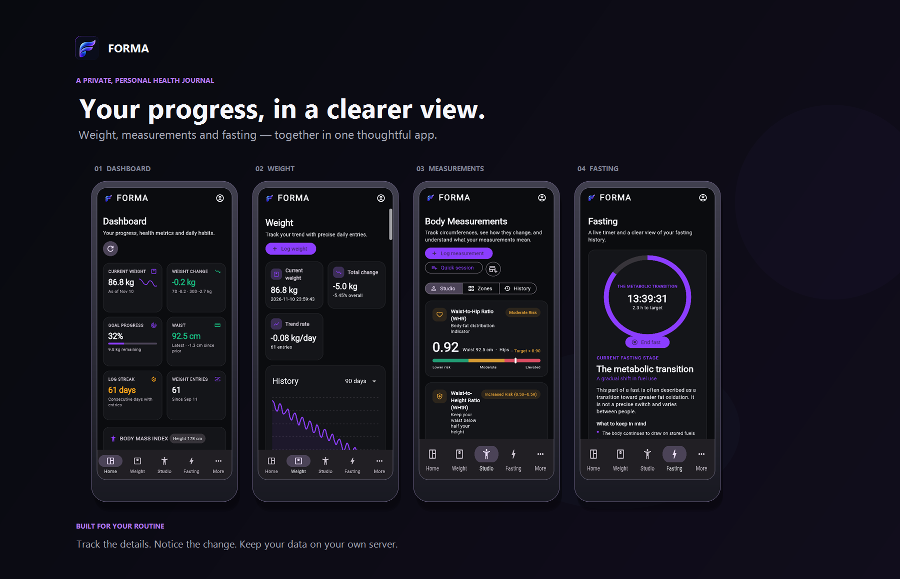

# Forma screenshots

Current Flutter interface, captured from the local demo instance using synthetic sample data.

## Desktop Web

<table>
<tr>
<td width="50%"><strong>Dashboard</strong> </td>
<td width="50%"><strong>Weight history</strong> </td>
</tr>
<tr>
<td><strong>Measurements studio</strong> </td>
<td><strong>Goals</strong> </td>
</tr>
<tr>
<td><strong>Nutrition</strong> </td>
<td><strong>Fasting</strong> </td>
</tr>
<tr>
<td><strong>Progress photos</strong> </td>
<td><strong>Data and backups</strong> </td>
</tr>
<tr>
<td><strong>Settings</strong> </td>
<td><strong>Administration</strong> </td>
</tr>
</table>

## Android

<table>
<tr>
<td width="33%"><strong>Dashboard</strong> </td>
<td width="33%"><strong>Weight</strong> </td>
<td width="33%"><strong>Measurements</strong> </td>
</tr>
<tr>
<td><strong>Fasting</strong> </td>
<td><strong>Navigation drawer</strong> </td>
<td></td>
</tr>
</table>
